👾 A equipe de IA da <b>CodeWave Systems</b> no turno 24/7: Jessica no suporte, Igor em vendas, Marcos no código, Alana no marketing, Bruno no QA e Gabrielle na agenda do chefe.

  

  

  

  

<picture>
  <source media="(prefers-color-scheme: dark)" srcset="https://raw.githubusercontent.com/Pedrovictorrr/pedrovictorrr/output/github-contribution-grid-snake-dark.svg"/>
  
</picture>

